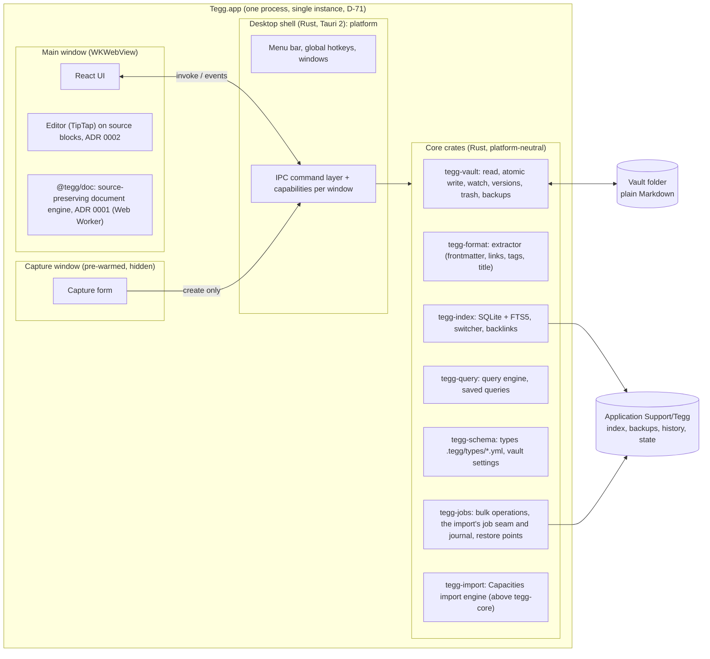
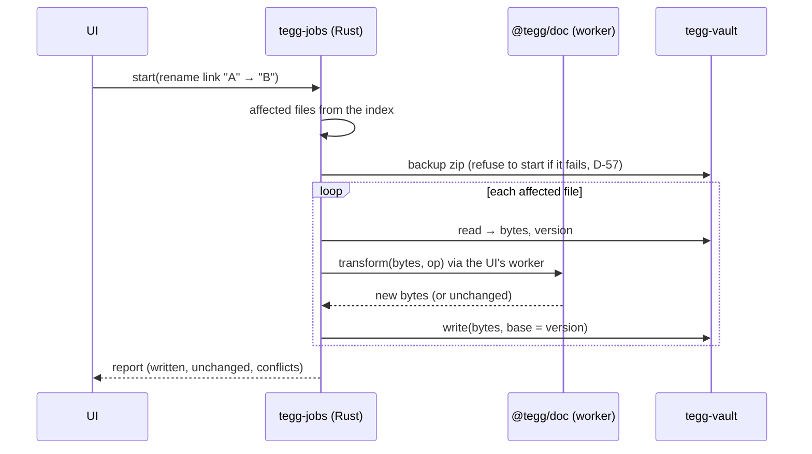

# Tegg Architecture

- **Status:** Accepted (2026-10-10). AP-29 → D-82 (ADR 0003), AP-30 → D-84, AP-31 → D-83.
- **Inputs:** BRD v1.13 (§8, §9, D-01…D-81), `docs/test-strategy.md`, ADR 0001 and 0002, spike findings S1–S5 (`spikes/*/FINDINGS.md`).
- **Scope:** the MVP (BRD §11, MS1–MS8), plus the seams v1.0, mobile and Phase 2 sync need, so they don't force a rewrite.

This document says which part owns what, how data moves between them, and how the non-negotiable rules are enforced by structure rather than by care. Requirement IDs in brackets say where a rule comes from.

---

## 1. Constraints that shape the design

| Rule | Architectural consequence |
| --- | --- |
| Files are the source of truth; the index is a cache (AR-01, NFR-POR-03) | Every piece of state is derivable from the vault, except machine-local state in Application Support. The index can be deleted at any time. No feature reads data that exists only in the index. |
| Round-trip safety, minimal writes (FR-FMT-07, FR-SYN-06) | Markdown is never regenerated. All text changes are **patches** to source ranges (ADR 0001), made by one engine (§3.2). No change → no write. |
| Atomic writes only (FR-SYN-02) | **One write function** in the whole app (data-safety FR-SYN-02 AC-1), in the Rust vault crate. Nothing else may open a vault file for writing (L0 check). |
| Never silently overwrite external changes (NFR-REL-02) | Every write carries the **version it was based on**; the writer refuses when the disk differs (§5.3). |
| Restore point before bulk operations (FR-HIS-04, D-57) | Bulk operations exist only as orchestrated jobs in the core (§5.6); the job runner takes the backup and refuses to start if it fails. |
| Core is platform-neutral (AR-03) | Core crates and TS packages have no Tauri, AppKit or menu-bar dependency (L0 dependency check). The desktop shell is a thin adapter. |
| No network (NFR-SEC-01) | No HTTP crates/packages; Tauri without the `http` plugin; CSP `connect-src` = IPC only; empty entitlements (S3). |
| Performance on 5,000 notes (NFR-PERF, D-59) | Index and queries in Rust (S4: 10–1000× headroom); editor work off the typing path (§8). |

---

## 2. System overview



- **One process.** Tauri's Rust side hosts the core; each window is a WKWebView. WebKit's helper processes are WebKit's, not ours (S3 P2).
- **Two webviews in the MVP:** the main window and the pre-warmed capture window (S3: open in ~40–50 ms). Closing a window hides it; the app lives in the menu bar (FR-CAP-01).
- **Two languages, each with one job** (§3). Rust owns the disk and everything derived from it. TypeScript owns changing Markdown text.

---

## 3. Components

### 3.1 Rust core (`crates/`)

All core crates are plain Rust libraries with no Tauri dependency, so they can serve a future mobile app on whichever platform is chosen (AR-03, D-100); platform-specific calls sit in `cfg`-gated items with a portable fallback (AR-03 AC-3) and run in `cargo test` against temp vaults (L4).

| Crate | Owns | Comes from |
| --- | --- | --- |
| `tegg-vault` | The vault as a file system: list, read (bytes + `FileVersion`), **the one write function** (temp `.<name>.tegg-tmp` in the same folder → `fsync` → rename; create via `RENAME_EXCL`, no clobber), delete to `.trash/` keeping the relative path, leftover temp clean-up, placeholder (online-only) detection, own-write tracking for echo suppression, backup zips. Behind a `VaultFs` trait (§10). | S3 `vault.rs`, data-safety ACs |
| `tegg-format` | Read-only extraction of id, type, title, attributes, links, tags, block ids from a file; file-name sanitizing (D-51, D-52, D-68, D-80); NFC (FR-FMT-12); date rules (FR-FMT-11). Kept equal to the TS engine by the conformance corpus (L3) and the nightly differential corpus. | S4 `extract.rs` |
| `tegg-index` | SQLite + FTS5 database in Application Support: notes, attrs, links, tags, FTS; rebuild (parallel, capped at cores − 2, S4 P8), per-path incremental update, offline catch-up by `(mtime, size)`, in-memory quick switcher, backlinks, unresolved links, duplicate `id` detection (FR-SYN-05), the local graph's neighbourhood query (`graph_neighbourhood`, v1.0, D-911, §5.9). Schema-versioned: a version mismatch means rebuild. | S4 |
| `tegg-query` | Query definitions (`.tegg/queries/*.yml`, query blocks) → SQL over the index; sorting/grouping; results paged for virtualized views (NFR-PERF-07). | MS6 |
| `tegg-schema` | Type definitions (`.tegg/types/*.yml`, versioned, AR-07), `vault.yml`, reserved keys (FR-TYP-15), defaults per type (folder, template). Validates; never rewrites a user file it doesn't understand. | MS3 |
| `tegg-jobs` | Bulk operations as jobs (§5.6): rename across the vault, tag rename, attribute rename, bulk type change, import. Takes the restore point, selects files from the index, sends text transformations to the document engine, writes through `tegg-vault`, reports progress and supports cancel before the write phase. For the import it keeps the queue, the backup, the journal and its roll-back (`Jobs::start_import`, `import_journal`; v1-import §9, §12.1); the import's planner lives in `tegg-import`. | S5, MS4/MS7 |
| `tegg-core` | The façade the shell calls: opens a vault, wires watcher → index → events, holds per-vault state. The only crate the shell depends on. | — |
| `tegg-import` | The Capacities import engine (slice I1, [v1-import.md](contracts/v1-import.md)): scan of a zip or folder (read in place), mapping, plan and accounting rule (S5), render specs for `@tegg/doc`, and the run as an `ImportJob` of `tegg-jobs`. **Sits above `tegg-core`** (v1-import §17 (1)): an import must run with no vault open (a new vault is written by a private engine over a temporary folder), and the planner needs the target's index. Platform-neutral (AR-03); all file access through `tegg-vault` (AR-04); never builds Markdown itself (D-82). The shell calls it next to `tegg-core`. | S5, slice I1 |

### 3.2 TypeScript (`packages/`, `app/ui/`)

| Package | Owns | Comes from |
| --- | --- | --- |
| `@tegg/doc` | The **document engine**: parse a note into original text + ranges, patch blocks (`editBlock`), frontmatter entries (`setAttribute`, `removeAttribute`), link targets (`renameLinkTarget`), tags; verify every patch by re-parsing (ADR 0001). Pure functions `bytes → bytes`, no DOM, no IPC, so it runs in the editor, in a Web Worker, and in Node tests. | S1 core |
| `@tegg/editor` | TipTap/ProseMirror on source blocks: load with losslessness check (made lazy, S2), normalization guard, Obsidian inline syntax as schema, `reconcile` + read-back verify + separator escalation (ADR 0002, D-67). | S2 |
| `app/ui` | React screens: note page, type pages, query views, search, switcher, home, inbox, daily, settings, conflicts, import wizard. Command registry: every action is a command with an id, a localized title and an optional shortcut, so the command palette reaches all of them (FR-UX-03). Strings externalized (NFR-OTH-02). Light and dark themes from one token set (FR-UX-05). | — |

**Single text engine (D-82, ADR 0003).** Every change to Markdown text, whether from typing, the attribute panel, a table cell edit, a link rename across 50 files, or import body conversion, goes through `@tegg/doc`. Rust never edits Markdown text; it only moves whole files' bytes. Reasons:
1. One implementation of the patch model and its verification instead of two that drift. S4 showed the two parsers already disagree in edge cases (P1, P3, P9), and S5 showed a regex shortcut silently losing links (F12).
2. The editor needs mdast anyway (ADR 0002); the micromark extensions for wikilinks, tags, highlights and math exist only there.
3. The engine is pure and small, so running it headless is cheap: a Web Worker in the main webview for jobs, Node for tests and tools.

Rust still parses for **reading** (index, queries), because indexing 5,000 notes must not wait for a webview (S4: 925 ms). The conformance corpus keeps both readers equal.

### 3.3 Desktop shell (`app/src-tauri/`)

Tauri 2 app: windows and their lifecycle (pre-warmed capture, hide on close), menu bar icon and menu, global hotkeys (configurable; registration failures shown in Settings, D-71), single-instance guard (D-71), IPC command handlers (thin: validate, call `tegg-core`, map errors), event forwarding, capabilities per window, update check (opt-in, the only allowed network call, later). Nothing in the shell touches files directly.

---

## 4. Data and identity

### 4.1 Where data lives

| Data | Location | Rebuildable? |
| --- | --- | --- |
| Notes, attachments, types, saved queries, templates, vault settings | Vault (BRD §5.1, FR-STO) | It *is* the truth |
| Deleted objects | `<vault>/.trash/<original relative path>` (data-safety FR-STO AC-5) | — |
| Index (`index.sqlite`) | `~/Library/Application Support/Tegg/vaults/<vault-key>/` | Yes, always (AR-01) |
| Backups before bulk operations (newest 10, D-57) | `…/Tegg/vaults/<vault-key>/backups/` | No (that's their point) |
| Version history (v1.0, FR-HIS-03) | `…/Tegg/vaults/<vault-key>/history/` | No |
| Window state, recent notes, per-machine settings, hotkeys | `…/Tegg/` | Losing them is harmless |

`<vault-key>` is a hash of the vault's canonical path. Moving the vault folder gives a fresh index (rebuilt) and orphans the old backups folder, which Settings can show.

### 4.2 Identity

- **Object identity:** the `id` frontmatter key (FR-FMT-02), written on first edit for files that lack one (D-54/AP-4). Until then the index identifies a file by its path.
- **Links** resolve by file path / `id`, never by title alone (FR-LNK-14); duplicate ids are conflicts (D-53, FR-SYN-05).
- **File version:** `FileVersion { mtime, size, hash }` (BLAKE3 of the bytes). Every read returns one; every write states the version it replaces (§5.3).

---

## 5. Key flows

### 5.1 Open a vault

1. The shell asks `tegg-core` to open the folder. `tegg-vault` cleans `.tegg-tmp` leftovers older than 1 minute, detects online-only placeholders and skips them (FR-VLT-03).
2. `tegg-schema` loads `.tegg/` (types, settings, queries).
3. `tegg-index` opens its database. If it is missing or its schema version differs, it rebuilds in the background; otherwise it catches up on offline changes by `(mtime, size)` (S4: 146 ms for 100 changed files). The UI is usable at once; results fill in as indexing proceeds (NFR-PERF-02).
4. The watcher starts. **Zero writes** to the vault on open (FR-SYN-06 AC-1).

### 5.2 Open and edit a note

```mermaid
sequenceDiagram
  participant E as Editor (main thread)
  participant W as @tegg/doc (worker)
  participant C as Core (Rust)
  E->>C: read(path)
  C-->>E: bytes, version v1
  E->>E: parse, load blocks (lazy losslessness check)
  Note over E: user types; autosave debounced ≤ 1 s (FR-EDT-08)
  E->>W: reconcile(original, changed blocks)
  W-->>E: new bytes (verified by re-parse + read-back)
  E->>C: write(path, bytes, base = v1)
  alt disk still v1
    C-->>E: ok, version v2
  else disk changed
    C-->>E: conflict(disk version)
    E->>E: merge dialog (FR-SYN-03 AC-3)
  end
```

- Untouched blocks are copied byte-for-byte; only changed blocks are rendered; nothing changes → nothing is written (ADR 0002).
- `reconcile` and its verification run in the worker so a long note can't stall typing (S2: save grows with note size).
- Attribute edits (panel, table cell) are `setAttribute` patches through the same engine. For a note that isn't open, the UI reads it, patches it in the worker, and writes with the version it read.
- `modified` changes only when content or an attribute actually changed (D-55/AP-5).

### 5.3 The write path (one function)

`tegg-vault::write(path, bytes, base: Option<FileVersion>)`:

1. If `bytes` equal the file's current bytes → return without writing (FR-SYN-06).
2. Read the current version. If it differs from `base` → `Conflict` (FR-SYN-03 AC-7). A missing file with a `base` → `Gone` (AC-4).
3. Write `.<name>.tegg-tmp` in the same folder, `fsync`, rename over the target (create: `renamex_np(RENAME_EXCL)`, so an existing name fails instead of being replaced; S3 P3).
4. Record the new version as **own write**, so the watcher event it causes doesn't trigger a reload (echo suppression), then update the index for that path directly.

Writes to one path are serialized. There is a small window between step 2 and the rename in step 3 in which an external write could land and be replaced; POSIX offers no lock that sync clients respect. The window is under a millisecond and sync clients also replace files atomically, so the risk is very small but not zero; accepted as a documented limit (D-84).

### 5.4 External changes

Watcher (FSEvents via `notify`, 30 ms settle window, S4) → for each changed path: file exists → re-index, gone → remove (event kinds are never trusted; a changed folder is reconciled both ways, S4 P4; "must rescan" → full catch-up) → `vault:changed` event with the paths.

The note page reacts: **no unsaved edits** → reload silently, keep the cursor (AC-2); **unsaved edits** → keep them, write nothing, show the merge dialog (AC-3); **deleted** → keep the content, offer Restore / Discard (AC-4). Renames keep identity by `id` (AC-5). 500 changes at once are processed in batches off the UI thread (AC-6).

### 5.5 Create (capture, new object, attachment)

The capture window may only call `capture_create(type, title, text)` (capability-restricted, NFR-SEC-03; D-552), which creates create-exclusive and refuses non-capture types and texts without `review: unreviewed` and `captured`. Core: sanitize the title into a file name (D-52, D-68, D-80), pick the type's folder, write with `RENAME_EXCL`; a taken name gets ` (2)`, ` (3)` … (FR-LNK-14). New notes are rendered in the canonical dialect style by `@tegg/doc` `newObject` on the UI side, the capture window included (it bundles `@tegg/doc`; the pre-warmed window hides the cost; D-245, D-552).

### 5.6 Bulk operations (jobs)



- Only files whose bytes actually change are written (FR-SYN-06 AC-3).
- A conflict on one file (changed during the job) skips that file and lists it; the backup covers the rest.
- Jobs run while the main webview exists. Closing the window hides it (S3), so the worker stays alive; quitting during a job waits for the current file, then stops and reports.

### 5.7 Import (Capacities, MS7)

The S5 planner is the crate `tegg-import`, **above `tegg-core`** (not inside `tegg-jobs`, as this section first sketched; v1-import §17 (1)): an import must run with no vault open, and the planner needs the target's index. `tegg-jobs` keeps the queue, the backup and the journal (`Jobs::start_import`, v1-import §12.1). The engine: read the zip with UTF-8 names (FR-IMP-07), pick a space, map types and attributes, plan file names and link outcomes, show the preview, check the accounting rule (§11.1). On confirm: backup if the vault isn't empty, then for each object the worker renders the new note (frontmatter from the mapping, body links rewritten **from the mdast parse**, S5 F12), and `tegg-vault` creates the files and copies attachments. Cancel before the write phase leaves the vault byte-identical. The report is written as a Page.

### 5.8 Search, switcher, queries

All answered by Rust from the index: switcher in memory (S4: 0.5 ms), FTS with diacritic folding and no prefix expansion for one-character words (S4), queries as SQL (S4: 2.3 ms for 1,000 rows). The UI virtualizes long lists (NFR-PERF-07).

### 5.9 Local graph (v1.0)

The core answers `graph_neighbourhood(centre, depth, hidden types, hidden kinds, cap)` from the index's link and tag tables (D-911, `docs/contracts/v1-graph.md` §1): edges by kind (link, relation, embed, tag; D-900, D-971…D-974), a breadth-first walk with Tag nodes and Daily Notes as leaves (D-903), filters that drive the walk (D-904), vault-wide degree (D-975) and the 150 / 1,000 caps (D-912, D-978). No new extraction and no stored graph, so a rebuild gives the same answer (AR-01); a new request from the window cancels the running one. The UI lays the result out with d3-force and draws SVG (ADR 0004), re-asks on every `vault:changed` and redraws only when the answer changed (D-980). The graph never writes the vault; its view state is machine-local in `ui-state.json` (D-993).

---

## 6. IPC contract

- **Commands** (UI → core, request/response) and **events** (core → UI). Types are generated from Rust into TypeScript, so the two sides can't drift; the generated file is checked in and verified by L0.
- Command groups: `vault.*` (open, settings), `note.*` (read, write, create, delete, restore, rename), `index.*` (switcher, search, backlinks, unresolved, conflicts), `query.*`, `schema.*`, `job.*` (start, progress, cancel, report), `capture.*`.
- Events: `vault:changed`, `index:progress`, `job:progress`, `note:conflict`.
- **Capabilities per window** (Tauri 2): the capture window gets `capture.*` only; the main window gets everything except shell-internal commands. The CSP allows `self` and IPC only.
- Payloads are bytes for note content (the engine owns decoding: BOM, CRLF are content, ADR 0001), paths relative to the vault in NFC.
- The L5 fake core implements the same contract over `@tauri-apps/api/mocks` with an in-memory vault (test-strategy L5).

---

## 7. Errors and invalid files

- Invalid frontmatter: indexed by file name and body, opened in source mode with a warning, never rewritten automatically (NFR-REL-03).
- A block the editor can't represent losslessly is read-only raw (ADR 0002); a save whose verification fails is refused, never written damaged.
- Core errors are typed (`Conflict`, `Gone`, `NameTaken`, `Placeholder`, `InvalidFrontmatter`, `Io`) and mapped to localized messages in the UI.

---

## 8. Performance plan

| Target (D-59 reference) | Plan | Evidence |
| --- | --- | --- |
| PERF-01 cold start < 2 s | Show the UI from the last window state before the index finishes catching up | MS2 measurement |
| PERF-02 full index < 30 s, non-blocking | Parallel rebuild, capped pool, background | S4: 925 ms |
| PERF-03 switcher < 100 ms | In-memory folded titles/aliases | S4: 0.5 ms |
| PERF-04 search < 200 ms | FTS5, no one-letter prefix expansion | S4: 39 ms |
| PERF-05 open note < 150 ms (112 ms reference) | **Lazy** losslessness check (first touch of a block), not all blocks on open | S2: 114–126 ms before the change; check was ~45 ms of it |
| PERF-06 typing in the next frame | Reconcile and verify in the worker; verify only the changed region plus neighbours | S2: p95 16 ms |
| PERF-07 query view < 300 ms | SQL + virtualized list | S4: 2.3 ms core |
| PERF-08 external change < 2 s | FSEvents + per-path update | S4: 70 ms |
| PERF-09 memory < 400 MB | One process + two webviews | S3 + S4: ~285 MB |
| PERF-10 capture < 300 ms | Pre-warmed hidden window | S3: 39–47 ms |
| PERF-11 local graph depth 2 < 300 ms (225 ms reference, D-986) | Index query without file reads, capped at 150 nodes; d3-force run to rest synchronously (ADR 0004) | v1.0 G1 benchmark |

---

## 9. Security and privacy

No HTTP crates or packages outside an allow-list; no Tauri `http` plugin; CSP `connect-src` IPC only; empty entitlements; the L6 `lsof` monitor fails on any non-IPC socket (NFR-SEC-01). The capture window can only create (NFR-SEC-03). Nothing machine-local is written into the vault (FR-STO-07). Files are unencrypted by design (NFR-SEC-02).

---

## 10. Seams for later

| Later need | Seam now |
| --- | --- |
| Phase 2 API sync (FR-SYN-20, AR-04) | `VaultFs` trait in `tegg-vault` (list, read, write, create, delete, watch). The MVP has one implementation (local folder). A `SyncAdapter` trait sits beside it with a no-op folder-sync implementation; API sync implements it later without changing jobs, index or editor. |
| Mobile (D-02) | Core crates have no desktop dependencies; `@tegg/doc` and `@tegg/editor` have no Tauri imports (only `app/ui` talks IPC, through one client module). |
| AI (AR-05) | Read-only content API over the index (`index.*` commands), an empty `embeddings` table slot in the index schema, command-registry entries. Nothing implemented in v1. |
| Version history (v1.0) | The write path already has the before-bytes in hand; history snapshots hook in at step 3 of §5.3. |

---

## 11. Repository layout

```
crates/            tegg-vault, tegg-format, tegg-index, tegg-query, tegg-schema, tegg-jobs, tegg-core, tegg-import
packages/          @tegg/doc, @tegg/editor
app/ui/            React app (Vite)
app/src-tauri/     desktop shell
tests/fixtures/    shared fixtures (format, vaults, import, conformance)
tools/             gen-vault, qa
spikes/            throwaway (S1–S5), not imported by product code
```

One Cargo workspace for the core crates; the desktop shell `app/src-tauri` has its own manifest, so core builds never need the web assets Tauri embeds (D-114). One npm workspace. Each package gets a `qa.config.json` step. Product code **ports** spike modules deliberately, with tests re-authored from the ACs by the test author (D-61); it never imports from `spikes/` (L0 check).

### Architecture checks (L0, test-strategy TS-L0)

- One write function: no `File::create`/`OpenOptions::write`/`fs::write` on vault paths outside `tegg-vault::write`; no file writes in TS at all.
- Core crates and `packages/*` don't depend on `tauri`, AppKit or `app/`.
- No network crates/packages outside the allow-list.
- Rust never edits Markdown text: only `@tegg/doc` produces new note bytes (checked by keeping Markdown rendering out of the Rust crates' dependencies, D-82).
- No imports from `spikes/`.

---

## 12. Milestones → components

Milestone names and requirements as in BRD §11.2; full requirement mapping in [requirements-coverage.md](requirements-coverage.md).

| Milestone | Builds |
| --- | --- |
| MS1 Vault core & file format | `tegg-vault` (write path, trash folder, temp clean-up, versions, `VaultFs` seam), `@tegg/doc` (from S1), file-name and date rules in `tegg-format`, fault-injection harness, L0 architecture checks |
| MS2 Index, watcher, search, switcher | `tegg-format` extractor, `tegg-index`, watcher, `tegg-core`, IPC skeleton, shell with main window, progress events |
| MS3 Types, attributes, editor | `tegg-schema`, attribute panel, type pages with default views (first fixed-definition `tegg-query`), `@tegg/editor` (from S2), read view on `@tegg/doc` (D-117), app layout with every designed page (TBD placeholders for later phases, D-116), command registry, themes, string externalization. Delivered in slices 3A–3E with preview builds (D-115) |
| MS4 Links, tags, renames, daily notes | `tegg-jobs` (link, tag and attribute renames through the worker), backup zips before bulk operations, daily notes, embeds |
| MS5 Tasks, capture, inbox, home | task list and board, block → object conversion, capture window, menu bar, hotkeys, single instance, Inbox and Home sections |
| MS6 Images, PDFs, trash | Image/PDF objects, `_attachments/`, trash view and restore |
| MS7 Capacities and Obsidian importers | import planners (Capacities from S5; Obsidian: open in place or copy, plain Markdown folders, D-93) in `tegg-jobs` + body transformation in the worker |
| MS8 MVP hardening & release | performance on the reference machine, signing and notarization, two-Mac sync, soak |

The visual query builder and saved queries are v1.0; the MVP's lists (type pages, tasks, Inbox, Home) use fixed query definitions.

---

## 13. Risks and known limits

- **Two readers** (Rust extractor, TS engine) can still disagree on edge cases; controlled by the conformance corpus (every push) and the differential corpus (nightly), with known differences listed (S4 P3).
- **Jobs depend on the main webview** (D-82): a job can't run with no webview at all. Acceptable on desktop, where the hidden window stays alive.
- **Compare-then-rename window** (§5.3, D-84).
- **FSEvents coalescing** under heavy sync load: covered by the "must rescan" path and the 500-file AC.

---

## 14. Decided points (AP-29 → D-82, AP-30 → D-84, AP-31 → D-83)

| # | Issue | Proposal | Affects |
| --- | --- | --- | --- |
| AP-29 | **Who changes Markdown text outside the editor** (bulk renames, attribute edits on unopened notes, import body conversion)? ADR 0001 gives body writes to TypeScript but leaves bulk rewrites open; S5 put the importer in Rust. Two patch engines would drift (S4 P1/P3/P9, S5 F12). | **One text engine:** `@tegg/doc` produces every new note's bytes; Rust orchestrates (file selection, backup, conflict checks, atomic writes) and runs jobs through a Web Worker in the main webview. The import *planner* stays in Rust. **Accepted (D-82, ADR 0003).** | ADR 0001, FR-LNK-03, FR-TAG-04, FR-TYP-04, FR-IMP-*, AR-03 |
| AP-30 | **Residual overwrite window.** Between checking the disk version and the atomic rename, an external write can land and be replaced; no file lock is respected by sync clients. NFR-REL-02 says "never". | Accept the sub-millisecond window as a documented limit. In v1.0, version history keeps the replaced bytes, so even that case is recoverable. **Accepted (D-84).** | NFR-REL-02, FR-SYN-03 |
| AP-31 | **Spike code in the product.** CLAUDE.md calls spike code throwaway, while S5 says its parsing and mapping become the importer. | Port spike modules into product packages deliberately (reviewed, cleaned up), with tests re-authored from the ACs by the test author; product code never imports from `spikes/`. **Accepted (D-83).** |  D-61, TS-I |

---

## 15. Decision records

- [ADR 0001](adr/0001-source-preserving-documents.md): source-preserving documents (patch, don't regenerate).
- [ADR 0002](adr/0002-editor-on-source-blocks.md): block editor on source blocks.
- [ADR 0003](adr/0003-one-text-engine.md): one text engine; Rust orchestrates (D-82).
- [ADR 0004](adr/0004-graph-layout-d3-force-svg.md): graph layout with d3-force, drawn as SVG (D-913).
