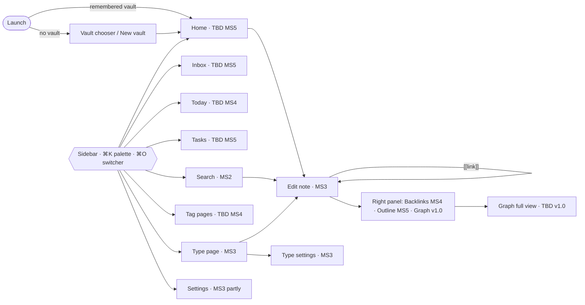

# MS3 implementation plan: Types, attributes, editor

- **Status:** accepted, 2026-10-12. AP-59…AP-64 (§7) were accepted by the owner as D-115…D-120 (BRD v1.25).
- **Scope:** BRD §11.2 MS3 (37 requirements), architecture §12, `docs/requirements-coverage.md` § MS3, and the MS3 parts of MS2 ACs (D-111).
- **Owner's goals for this revision:**
  1. Build the whole macOS shell from the designs in `design/edit-note-page/`, with a **TBD** page wherever the content comes after MS3, so the page flow can be tried.
  2. Let the owner test with real use earlier.
  3. Let the owner use what is already built.
  4. Explain why the current app shows raw Markdown instead of a formatted note.

---

## 1. Why the app shows raw Markdown (goal 4)

This is by design for MS2, not a regression. The MS2 shell has no Markdown renderer or editor yet:

- [App.tsx:104-107](../../app/ui/src/App.tsx) renders the opened note as `<h1>{note.path}</h1><pre>{note.text}</pre>`, so the file's bytes are shown verbatim.
- The MS2 shell contract ([ms2-shell.md](../contracts/ms2-shell.md) §2) has only `note_read` and `note_create`. There is no `note_write`, so nothing could be edited or saved even with an editor.
- The block editor exists only as the S2 spike (`spikes/s2-editor/`). D-83 forbids importing spike code into the product: `@tegg/editor` has to be ported into `packages/` first. That port is MS3 work (architecture §12).

**Fix in this plan:** slice 3B (§3) adds a read-only rendered view built on `@tegg/doc`, which the app already uses. The current `<pre>` view becomes the read-only source view (FR-EDT-10). Slice 3C then replaces the rendered view with the editor.

---

## 2. What you can use today (goal 3)

MS2 is a working app, though narrow. Build it once and open it:

```bash
cd app && npm run app:build
```

The app is `app/src-tauri/target/release/bundle/macos/Tegg.app`. With it you can:

| Works now | How |
| --- | --- |
| Open a Tegg vault folder | First launch: "Open vault folder". The app remembers it (FR-VLT-01 AC-7) |
| Full-text search with filters | ⌘⇧F; type, tag, date and attribute filters (FR-SRC-01…04, D-107…D-109) |
| Quick switcher, create from it | ⌘O; typo-tolerant, NFC/NFD-safe; ↩ on "Create …" makes a new note (FR-NAV-01) |
| Live updates from outside | Edit a note in Obsidian or a text editor; search updates (FR-SYN-03…05) |
| Indexing progress, iCloud placeholder banner | FR-UX-07, FR-VLT-03 |

**Content to try it on:** the generated reference vault (`cargo run --release --manifest-path tools/gen-vault/Cargo.toml -- --seed 1 --small-images --out ~/TeggTest`) or a fresh vault of your own. A Capacities space can't be opened yet: the importer is MS7 (D-93), and until then a non-Tegg folder shows "Import isn't available yet".

What MS2 can't do: show a note formatted, edit or save a note, list a type's objects, or navigate anywhere except through search and the switcher. Slices 3A–3C fix that first (§3).

---

## 3. MS3 in five slices, each ending in a build you use (goal 2)

MS3 has 37 requirements, of which 6 have ACs today. Building all of it before the owner sees anything would put the first real use weeks away. Instead MS3 is cut into five vertical slices. Each slice:

1. gets its ACs written (ac-author) and its red tests committed (test-author) **just before** it starts, as D-61 requires per milestone, applied per slice;
2. ends with `./verify push` green, the slice's ACs green, and an explorer session on a generated vault;
3. ships a **preview build** to the owner with a short "what to try / what's TBD" note and a 15-minute test charter (§5).

The MS3 milestone gate (`./verify milestone --milestone MS3`) is unchanged and still runs once, at the end of 3E.

| Slice | What you get | Requirements | Exit build lets you… |
| --- | --- | --- | --- |
| **3A Frame and page flow** | The window from the designs: sidebar, centre pane, right panel, every designed page reachable, TBD placeholders for later pages (§4); command palette; light/dark themes; externalized strings; vault chooser and "New vault" (empty) | FR-UX-01, -02, -03, -05, NFR-OTH-02; FR-VLT-01 AC-1; FR-UX-07 [manual] and FR-VLT-03 AC-1 (MS2 ACs deferred to MS3, D-111) | click and ⌘K through the whole app's page flow, in both themes |
| **3B Read view** | Notes render formatted (headings, lists, checklists, quotes, callouts, code, tables, Mermaid as code), `[[links]]` and `#tags` clickable, frontmatter shown as a read-only attribute strip, source view toggle | FR-EDT-10, NFR-PERF-05; FR-EDT-02 block types (display only); FR-TYP-08 universal attributes (display) | browse a vault like a reader: open, follow links, search, read source |
| **3C Editor and autosave** | `@tegg/editor` ported from S2 (D-83); `note_write` IPC with base version; autosave ≤ 1 s; undo/redo; slash menu, Markdown shortcuts, floating toolbar, `[[` and `#` autocomplete; multi-block selection; paste of text, HTML and URLs; external-change reload and the merge dialog | FR-EDT-01…06, -08, -09, -13, -14 (image paste waits for MS6), -15, NFR-PERF-06; FR-SYN-03 AC-2, -3, -4, -6 and FR-SYN-04 AC-3 (D-111) | **write real notes every day**, untyped (Page) |
| **3D Types and attributes** | `tegg-schema` with versioned type files; attribute panel; type settings page; type pages with the default list view (first fixed-definition `tegg-query`); create, change and delete types; review flag; preview attributes; starter vault | AR-07, FR-TYP-01…09, -11…13, FR-EDT-07, FR-VLT-02 (starter, D-92) | use typed objects: Meetings, People, Projects, Reading Notes |
| **3E Settings and polish** | Appearance settings (font, size, width, accent); date/time format, first day of week; MS3 gate | FR-SET-02, -03 (FR-TYP-14 removed, D-217) | the full MS3 app; gate passes |

Order rationale: 3A is first because every later page needs the frame and you asked to see the flow. 3B is cheap (it reuses `@tegg/doc` parsing) and fixes the raw-Markdown view weeks before the editor lands. 3C comes before 3D because writing notes is the most useful daily thing, and the attribute panel in 3D sits on top of the editor.

FR-TYP-04 and FR-TYP-07 appear in both MS3 and MS4 in BRD §11.2. Their existing ACs carry the milestone markers (D-94); 3D builds the MS3 parts, the rename and link rewrites stay in MS4.

---

## 4. The full shell with TBD pages (goal 1)

Slice 3A builds every region and page shown in the designs. A page whose content belongs to a later milestone shows a **TBD placeholder** instead of being hidden, so the flow (where you click, what opens where, what the shortcut is) can be tried now.

### 4.1 Placeholder rule

A TBD page or panel shows: the page name, one line on what it will do, its milestone (`MS4`, `MS5`, `v1.0`…) and its requirement IDs, and a "View design" note naming the design board. Its sidebar entry, shortcut and command-palette entry already work and lead to it. Placeholders use externalized strings like any other UI (NFR-OTH-02), and a test lists every route as either *built* or *TBD with a milestone*, so a placeholder can't be forgotten when its milestone lands.

Inside a built page, a later feature shows as a disabled control with a "Coming in MSn" tooltip (for example "Turn into object" in the editor toolbar, MS5).

### 4.2 Page map

The exact route, panel, disabled-control and shortcut lists are tables R1–R4 in `docs/acceptance/app-shell.md` (D-121…D-138); this map is the overview.

| Region or page | Design board | In MS3? | Later content (milestone, requirements) |
| --- | --- | --- | --- |
| Vault chooser, New vault (Empty / Starter) | — | **built** (3A, starter 3D) | — |
| Title bar with tabs | Main | one tab only; ⌘T and "+" disabled | tabs v1.0 (FR-NAV-06) |
| Title bar: Back / Forward (⌘[ / ⌘]) | Main | disabled (D-125) | MS5 (FR-NAV-03) |
| Sidebar: search field (⌘O), New object (⌘N) | all | **built** (3A) | — |
| Sidebar: Home | Home | TBD | MS5 (FR-HOM-01, -02) |
| Sidebar: Inbox (count) | Home | TBD | MS5 (FR-INB-01…04) |
| Sidebar: Today (⌘D) | Home | TBD | MS4 (FR-DLY-01…06) |
| Sidebar: Tasks | Home | TBD | MS5 (FR-TSK) |
| Sidebar: Types list with counts | all | **built** (3A, order D-121); `New type` disabled until 3D | — |
| Sidebar: Tags list with counts | Main | TBD | MS4 (FR-TAG-01…08) |
| Sidebar: Pinned | — | TBD | MS5 (FR-HOM-02, D-125) |
| Sidebar: Saved queries | — | TBD | v1.0 (FR-QRY) |
| Search page (⌘⇧F, palette) | — | **built** (MS2 content, D-125) | — |
| Conflicts view | — | TBD | MS3 · 3C (FR-SYN-04, -05; D-125) |
| **Edit note** (breadcrumb, Saved state, icon/cover, title, attribute panel, body) | Main | **built** (3B read, 3C edit, 3D attributes, 3E icon/cover) | — |
| Editor: slash menu, toolbar, `[[`, `#` | Main | **built** (3C) | items "Object embed", "Query", "Mindmap", "Turn into object" TBD: MS4 (FR-EMB), v1.0 (FR-QRY, FR-MMP), MS5 (FR-CNV) |
| Editor: embed cards of linked objects | Main | TBD card | MS4 (FR-EMB-01, -02, -04) |
| Editor: task blocks with status/priority/due | Main | shown as checklist | MS5 (FR-TSK) |
| Editor: mindmap block | Main | Mermaid shown as code | v1.0 (FR-MMP-01, -02) |
| Right panel: no Attributes tab; attributes stay at the top of the note (D-127) | Main | — | — |
| Right panel: Backlinks | Main | TBD | MS4 (FR-LNK-01…04); unlinked mentions v1.x (FR-LNK-05) |
| Right panel: Outline | Main | TBD | MS5 (FR-EDT-11, FR-NAV-05) |
| Right panel: Local graph | Main, Graph | TBD | v1.0 (FR-GRP-01…08) |
| **Type page** (list view, filter, sort, "New Idea") | Ideas | **built**: minimal list in 3A (D-123), full in 3D | "By status" grouped view, other views: v1.0 (FR-QRY) |
| **Type settings** (general, properties, options, preview properties, review, delete type) | TypeSettings | **built** (3D) | folder change and key rename rewriting files: MS4 (FR-TYP-04, FR-LNK); Templates and Views sections: v1.0 (FR-TPL, FR-QRY) |
| **Graph** full view | Graph | TBD | v1.0 (FR-GRP) |
| **Home** | Home | TBD | MS5 (FR-HOM-01) |
| Trash | — | TBD | MS6 (FR-HIS-01, -02) |
| Import | — | TBD | MS7 (FR-IMP, FR-STO-10) |
| Settings: Appearance, Date & time | — | **built** (3A theme, 3E rest) | other sections TBD with their milestones |
| Quick capture (route and window), menu bar | Home (shortcut shown) | TBD | MS5 (FR-CAP, S3 code) |

`Logos.dc.html` is a logo study, not a page; the app icon belongs to MS8 packaging.

### 4.3 Page flow



Until Home exists (MS5), launch opens the last note (by path, else by `id`) or, with none, the Home placeholder (D-132); the start screen setting itself is MS5 (FR-HOM-01) and v1.0 (FR-HOM-04).

### 4.4 Data the frame needs from the core

Defined in `docs/contracts/ms3-shell.md` (D-135): vault create and folder pick, last opened note, type definitions, type counts, the type list (minimal type page, D-123), per-machine UI state and `nav_opened` (D-138).

---

## 5. Owner testing loop (goals 2 and 3)

- **Preview build:** `npm run app:preview` builds and installs **Tegg Preview.app** into `~/Applications`, with its own bundle id and Application Support folder, so test runs and the preview never share an index (AP-62).
- **Test charter:** each slice's release note lists 5–10 things to try in about 15 minutes, and what is TBD.
- **Feedback:** write it in `docs/feedback/ms3-<slice>.md` or a GitHub issue labelled `dogfood`. Claude triages each point: a bug becomes a `bug_<issue>_<req-id>_…` red test (a data-loss bug stops feature work, D-62); a design change becomes an AP point; anything out of MS3 goes to the coverage doc with its phase.
- **Explorer first:** the explorer agent runs each slice's charter on a generated vault before the build reaches the owner, so the owner's time goes to the experience, not to crashes.
- **Claude never reads the owner's real vault** (D-62). The owner's feedback is what reaches Claude.

---

## 6. Data safety while dogfooding

- **3A and 3B write nothing** except notes you create explicitly (MS2 behaviour), so they are safe on a real vault.
- **From 3C the app edits files.** The write path is MS1's tested one (atomic, base-version check, no silent overwrite), but version history (FR-HIS-03) is v1.0. Until then: use a vault that has a backup (Time Machine, or a sync service with file versions), and start with notes you write in Tegg, not your only copy of anything.
- **No pre-MS7 import:** your Capacities content arrives with the MS7 importer. Pulling the importer forward was considered and not recommended: it depends on links, tags and attachments (MS4, MS6).

---

## 7. Decided points (AP-59…AP-64 → D-115…D-120, accepted 2026-10-12)

| # | Point | Proposal |
| --- | --- | --- |
| AP-59 | **MS3 in slices with preview builds.** D-61 asks for a milestone's ACs before the milestone; slicing writes them per slice. | MS3 is delivered as slices 3A–3E (§3). Each slice has its ACs and red tests before it starts, and ends in a preview build. The MS3 gate is unchanged and runs once at the end. **Accepted: D-115.** |
| AP-60 | **TBD pages in the product.** Later-milestone pages appear as placeholders in MS3 builds. | Adopt the placeholder rule (§4.1) and page map (§4.2). Placeholders have no ACs; one flow test checks every route is built or TBD-with-milestone. Each later milestone replaces its placeholders. **Accepted: D-116.** |
| AP-61 | **Read view before the editor.** A rendered read-only note view is not a BRD requirement on its own. | Build it as slice 3B. It becomes the view for files the editor can't open safely (NFR-REL-03 "source mode"), so it isn't throwaway. **Accepted: D-117.** |
| AP-62 | **Preview channel.** A second app identity on the owner's Mac. | `Tegg Preview.app`, bundle id `app.tegg.preview`, Application Support `~/Library/Application Support/Tegg Preview/`, ad-hoc signed until the Developer ID exists (S3). **Accepted: D-118.** |
| AP-63 | **What to dogfood on.** No importer before MS7; no version history before v1.0. | 3A–3B: the generated vault and a new real vault. From 3C: write new notes in a real vault that has a backup (§6). Capacities stays your main tool until MS7. **Accepted: D-119.** |
| AP-64 | **Shell and sidebar earlier than MS5.** FR-NAV-02 (palette), -04 (sidebar), -05 (right panel) are MS5, while FR-UX-02/-03 (layout, palette) are MS3. | MS3 builds the frame, palette and panel container with TBD entries; MS5 still owns completing them (all actions in the palette, Home/Inbox/Tasks, Outline), so no requirement moves. **Accepted: D-120.** |

Next: the ac-author drafts slice 3A's ACs and `docs/contracts/ms3-shell.md`.

## 8. Start conditions

- MS2 is merged to `main` (PR #20).
- Slice 3A starts with its ACs and `docs/contracts/ms3-shell.md`, then red tests (D-61, D-115).
