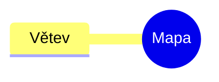
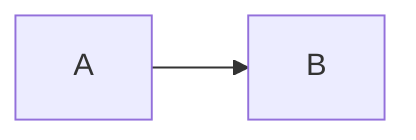

# Nadpis 1

## Nadpis 2

### Nadpis 3

#### Nadpis 4

##### Nadpis 5

###### Nadpis 6

Setext nadpis
=============

Odstavec s *kurzívou*, _kurzívou_, **tučně**, __tučně__, ~~přeškrtnuté~~, ==zvýrazněné==, `kód`, zalomení řádku  
druhý řádek a\
třetí řádek. Inline %%skrytý komentář%% konec. Matematika $x^2$ a ceny $5 and $3. Poznámka pod čarou[^1].

[^1]: Text poznámky pod čarou.

- odrážka
  - vnořená odrážka
- druhá odrážka

* hvězdička

+ plus

3. třetí
4. čtvrtý

1) závorka

- [ ] nehotovo
- [x] hotovo
- [X] hotovo velké

> citace
> druhý řádek citace

> [!warning] Pozor
> Text varování.

> [!note]
> Bez titulku.

> [!budget] Neznámý typ
> Text neznámého typu.

> [!caution] Alias
> Text aliasu.

> [!tip]- Složené
> Skrytý obsah.

> [!tip]+ Rozbalené
> Viditelný obsah.

```js
const a = "[[Kód]] #kód";
```

    odsazený kód

Před oddělovači.

---

***

___

| Vlevo | Střed | Vpravo |
| :--- | :---: | ---: |
| [[Cíl\|alias v tabulce]] | a \| b | 3 |





```query
type: page
```

```dataview
LIST
```

<div onclick="window.__teggPwned = 1">HTML blok</div>

<script>window.__teggPwned = 1</script>

<style>body { color: red }</style>

<iframe src="https://example.com"></iframe>

Inline <b>HTML</b> a  v odstavci.

%%
Komentářový blok
%%

$$
E = mc^2
$$

Odstavec s blokovým ID. ^abc123


